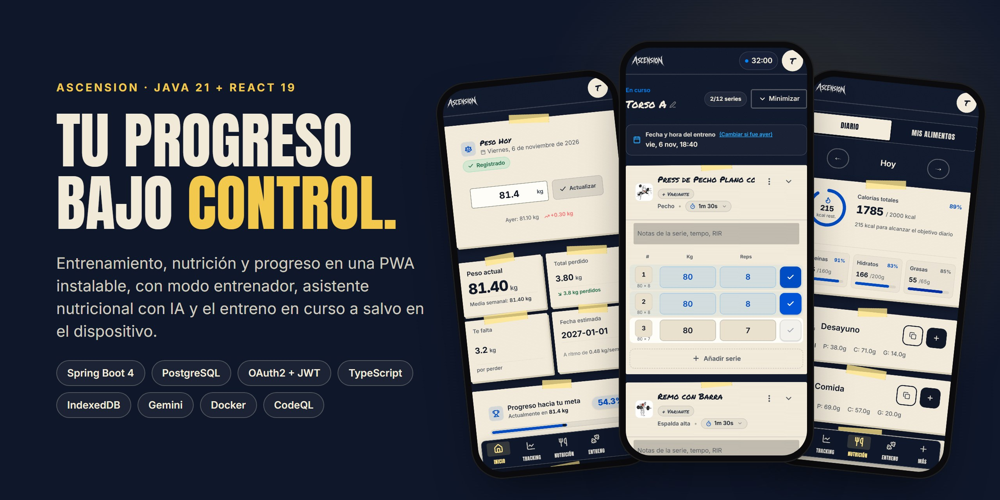
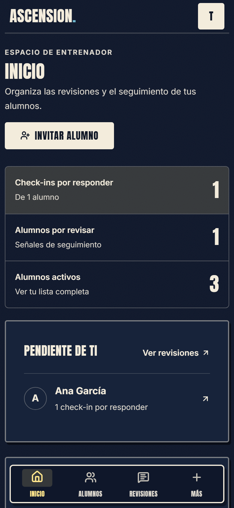
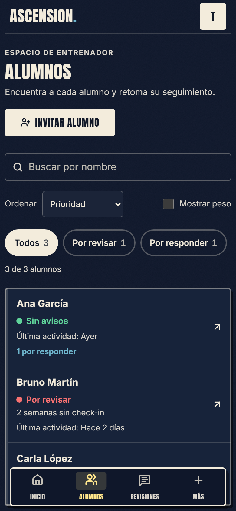
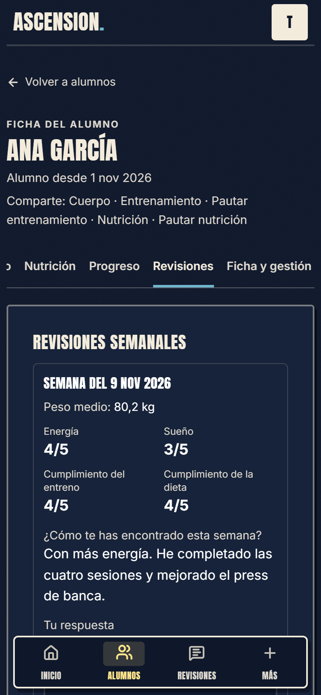
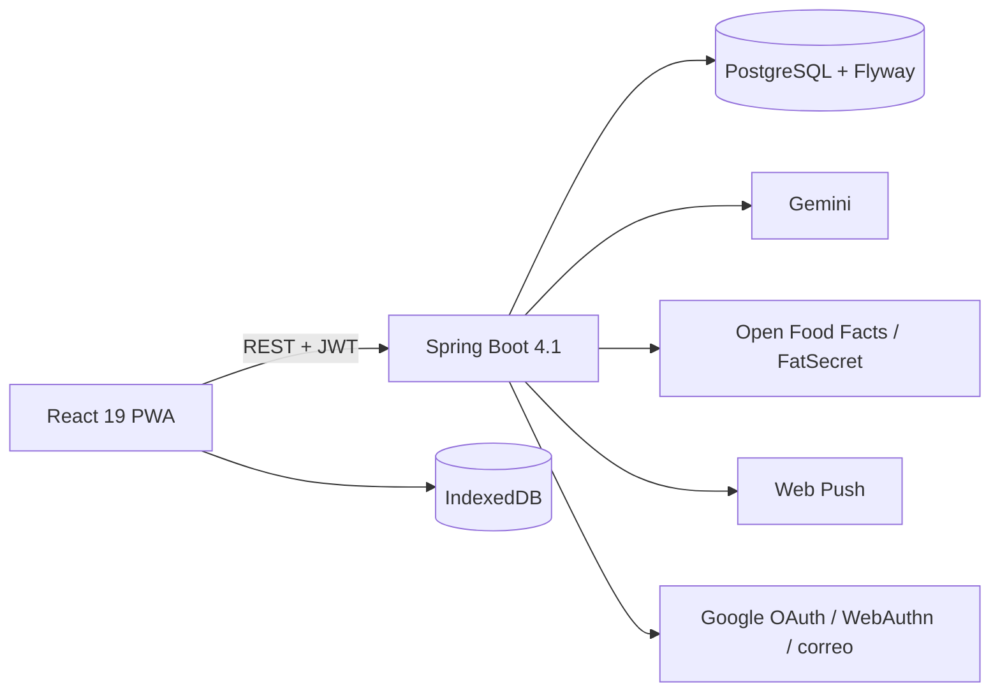

<div align="center">



# Ascension Tracker

**Entrenamiento, nutrición y progreso personal, con un espacio propio para entrenadores y alumnos.**

Aplicación full-stack con Java y React: desde el registro de una serie en el gimnasio hasta la revisión semanal de un alumno.

[](https://ascension.raclos.es)
[](https://github.com/RaclosDev/ascension-tracker/actions/workflows/ci.yml)


[Qué hace](#qué-hace) · [Decisiones técnicas](#decisiones-técnicas) · [Arquitectura](docs/architecture.md) · [Desarrollo y pruebas](docs/development.md)

</div>

## La app

<table>
  <tr>
    <td align="center" width="33%"><br><sub><b>Tu día</b> · entreno, comidas y progreso</sub></td>
    <td align="center" width="33%"><br><sub><b>Entreno en curso</b> · series, descansos y cronómetro</sub></td>
    <td align="center" width="33%"><br><sub><b>Nutrición</b> · calorías y macros del día</sub></td>
  </tr>
  <tr>
    <td align="center"><br><sub><b>Entrenador</b> · qué necesita atención</sub></td>
    <td align="center"><br><sub><b>Alumnos</b> · una ficha para cada persona</sub></td>
    <td align="center"><br><sub><b>Revisiones</b> · seguimiento y respuesta semanal</sub></td>
  </tr>
</table>

<sub>Interfaz React real, capturada con datos ficticios y API simulada. [Más pantallas y cómo reproducirlas](docs/screenshots/README.md).</sub>

## Qué hace

- **Entrenar:** crear rutinas, registrar series y variantes, consultar historial y récords, y controlar los descansos con avisos push. El entreno en curso se conserva localmente entre recargas.
- **Registrar comidas:** buscar alimentos, escanear códigos de barras, guardar recetas y seguir calorías y macros. Gemini ayuda a estimar comidas a partir de una foto y propone recetas; las estimaciones se pueden revisar antes de guardarlas.
- **Ver el progreso:** peso, pasos y resúmenes semanales, junto con fotos privadas y mapa de recuperación muscular. Importación de sesiones desde Hevy y exportación/restauración de datos.
- **Trabajar como entrenador:** inicio con tareas pendientes, cartera de alumnos, agenda de revisiones y ajustes profesionales. Bibliotecas de programas y pautas nutricionales con versiones, adaptación individual, borradores y permisos de cada alumno.
- **Preparar powerlifting:** perfiles y marcas de sentadilla, banca y peso muerto; competiciones con bloques y nueve intentos; seguimiento de cargas, volumen y RPE desde las sesiones. Las estimaciones de fuerza y los totales de competición se muestran por separado. [Funcionamiento y límites](docs/powerlifting.md).
- **Empezar como alumno:** invitación del entrenador, configuración inicial guiada y permisos para decidir qué datos compartir y qué puede pautar el entrenador.
- **Acceder a la cuenta:** Google, email y contraseña, o llaves de acceso (*passkeys*), con recuperación de contraseña por correo.

## Decisiones técnicas

El proyecto reúne interfaz, reglas de negocio, persistencia e infraestructura. Estos son algunos de los problemas que resuelve el código:

| Decisión | Aplicación |
| --- | --- |
| **Reintentos sin duplicados** | [`IdempotencyFilter`](backend/src/main/java/com/ascension/filter/IdempotencyFilter.java) conserva la clave, la firma de la petición y la respuesta para las escrituras protegidas. Una petición repetida recupera la respuesta anterior. |
| **Concurrencia en PostgreSQL** | Límites de uso con *token bucket* atómico compartido entre instancias, y temporizadores push reclamados con `FOR UPDATE SKIP LOCKED`. |
| **Tres formas de acceso, una sesión** | Google OAuth, email/contraseña y WebAuthn convergen en JWT de acceso en memoria y refresh token rotatorio en cookie `HttpOnly`. La [política de seguridad](SECURITY.md) recoge el alcance y cómo reportar problemas. |
| **Persistencia durante el entreno** | IndexedDB conserva el entreno activo y aísla el almacenamiento por cuenta. Los datos locales permiten recuperar esa sesión aunque se recargue la página; la sincronización con la API requiere conexión. |
| **Permisos por alumno** | El alumno controla por separado el acceso a cuerpo, entrenamiento y nutrición, además de la capacidad de pautar. El backend aplica esos permisos y registra el acceso del entrenador. |
| **Rendimiento medido** | Tests que cuentan las consultas SQL para detectar N+1, y presupuestos de tamaño de JS, CSS y precache comprobados en CI. |



## Cómo se verifica

- **Backend:** JUnit y Testcontainers sobre PostgreSQL para reglas de negocio, permisos, transacciones e integración.
- **Frontend:** Vitest y Testing Library para componentes y estado; Playwright con API simulada para recorridos de usuario, espacio de entrenador, aislamiento entre cuentas y cierre de sesión entre pestañas.
- **CI en GitHub Actions:** tipos, cobertura, formato, pruebas y build de las partes afectadas; presupuestos de JS/CSS/precache y comprobación de la CSP generada.
- **Análisis automatizado:** CodeQL, Trivy para imágenes de contenedor y actualizaciones de dependencias con Dependabot.

Las capturas validan el renderizado del frontend con fixtures; no sustituyen las pruebas de integración ni verifican servicios externos.

## Stack

| Área | Tecnología |
| --- | --- |
| Interfaz | React 19, TypeScript, Vite, Tailwind CSS, PWA (Workbox) |
| Estado | TanStack Query, Zustand, IndexedDB |
| API y acceso | Java 21, Spring Boot 4.1, Spring Security, JWT, WebAuthn, MapStruct |
| Persistencia | PostgreSQL 16, Spring Data JPA, Flyway |
| Integraciones | Gemini, Open Food Facts, FatSecret, Web Push, almacenamiento S3 |
| Pruebas | JUnit, Testcontainers, Vitest, Testing Library, Playwright |
| Automatización | GitHub Actions, CodeQL, Trivy, Docker Compose |

## Ejecutarla en local

```bash
cp .env.example .env
# Configura los secretos locales y las integraciones que vayas a utilizar.
docker compose up --build
```

Abre [localhost:3000](http://localhost:3000). La [guía de desarrollo](docs/development.md) explica la configuración base, la recarga en caliente y las verificaciones. Las integraciones de IA, alimentos, fotos, correo y notificaciones dependen de sus credenciales; no son necesarias para [reproducir las capturas](docs/screenshots/README.md).

## Autor

**Carlos Sanz Tomero**: desarrollador full-stack Java y React.

[](https://www.linkedin.com/in/carlos-sanz-tomero/)
[](https://raclosdev.github.io)

Código publicado bajo [licencia MIT](LICENSE).
