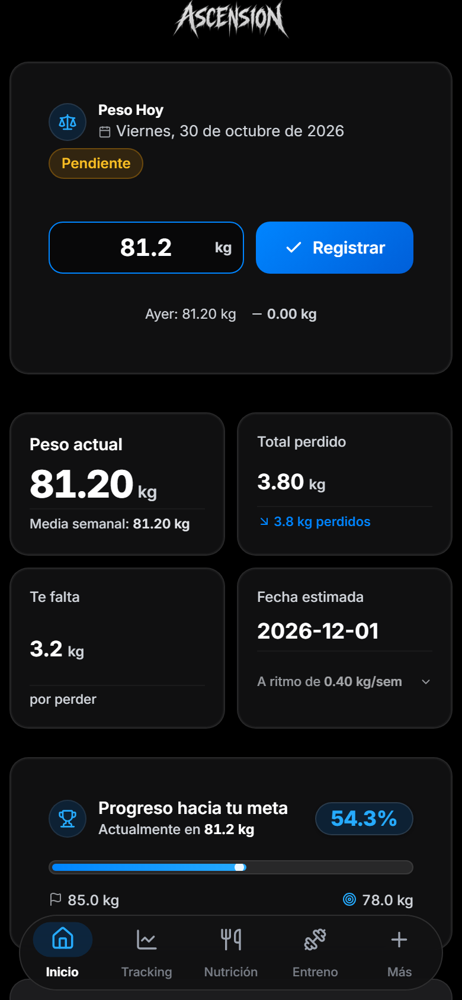
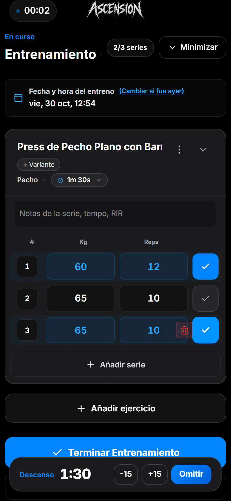
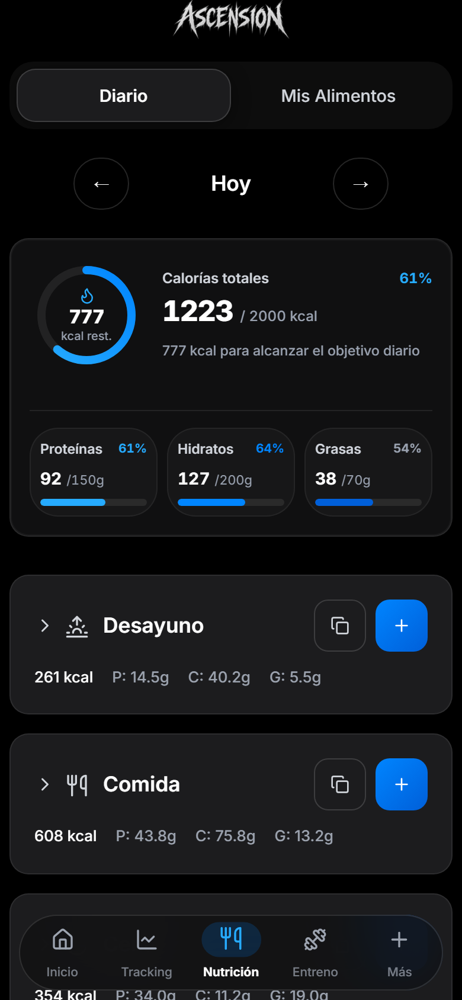
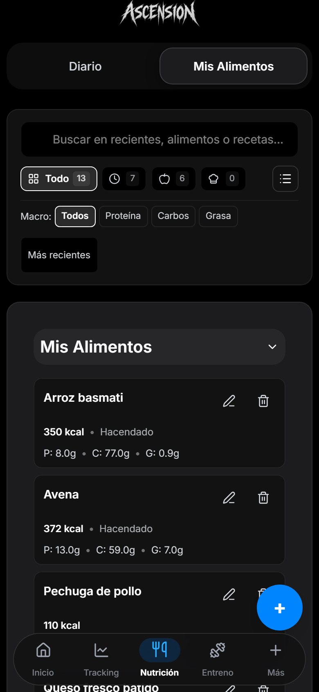
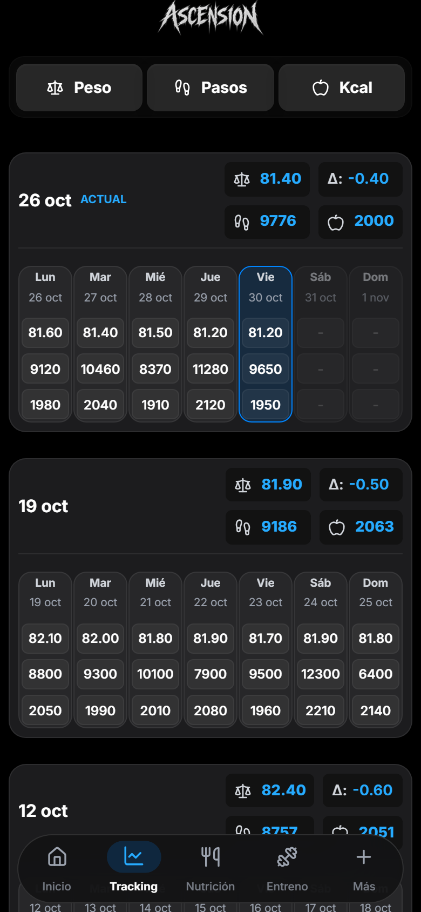
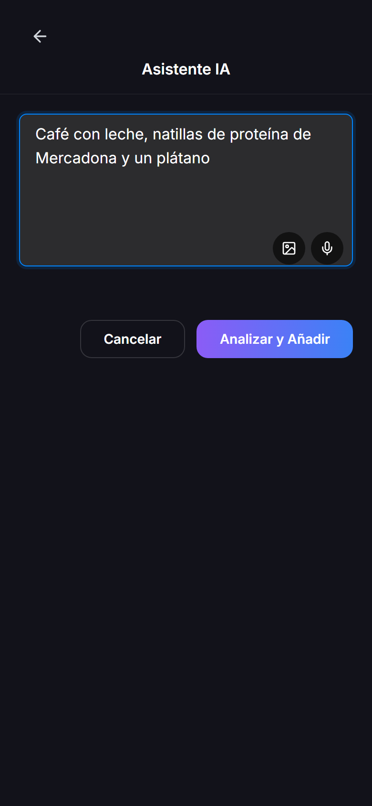

<p align="center">
  
</p>

<p align="center">
  <b>Progressive Web App (PWA) Full-Stack de fitness y nutrición con integración profunda de IA (Visión y Texto), temporizadores Push y biometría avanzada.</b>
</p>

<p align="center">
  
  
  
  
  
  
  
</p>

## 🚀 El Proyecto (Elevator Pitch)

**Ascension** no es otro clásico tracker de fitness; es una **Progressive Web App (PWA) de nivel producción** diseñada para resolver el problema del seguimiento físico unificando entrenamientos paramétricos, nutrición biométrica y asistencia por Inteligencia Artificial en una sola plataforma en la nube.

Desarrollada íntegramente como proyecto de portafolio, la aplicación demuestra un dominio Full-Stack moderno mediante arquitecturas resilientes:
- **Resiliencia Frontend:** Experiencia Offline-Ready gestionada por `Workbox` (estrategia NetworkFirst), sincronización de estado local ultrarrápida con `Zustand` + `IndexedDB` y notificaciones **Web Push** nativas.
- **Robustez Backend:** Arquitectura Spring Boot 3.3, mitigación de ataques DDoS mediante un Rate Limiter en memoria (`Caffeine`), mapeo seguro de DTOs (`MapStruct`) y erradicación del problema N+1 de Hibernate utilizando la interfaz `Persistable<String>`.
- **IA y APIs Integradas:** Orquestación nativa de la API de **Google Gemini** (Visión, OCR y Texto) para actuar como copiloto nutricional, y un proxy backend seguro (HMAC-SHA1) para consumir el catálogo de *FatSecret Platform*.

*(Nota: UI, parseo de fechas y locale configurados estrictamente en Español `es-ES`).*

---

## 📸 Capturas de Pantalla

<p align="center">
  
  
  
</p>
<p align="center">
  
  
  
</p>

---

## ✨ Funcionalidades Avanzadas (Core)

Lo que diferencia a Ascension de otras aplicaciones comerciales es su nivel extremo de detalle paramétrico y su UX orientada a atletas avanzados:

### 🏋️ Motor de Entrenamientos y Variantes
- **Micro-Variaciones (El factor diferencial):** A diferencia de otras apps, Ascension separa el historial y los Récords Personales (PRs) no solo por ejercicio, sino por **Máquina** (Polea, Smith, Libre) y **Agarre** (Prono, Supino, Neutro). *Un Press de Banca en Multipower se rastrea independientemente de un Press con Mancuernas.*
- **Tipos de Serie Complejos:** Soporte nativo para series de *Calentamiento* (ignoradas en el volumen total), *Dropsets*, *Al Fallo* y series cardiovasculares (Distancia y Duración).
- **Temporizador Background Push:** El Service Worker dispara notificaciones Web Push de "Descanso Terminado" (con vibración rítmica) que despiertan tu móvil incluso si está bloqueado o estás navegando en otra app.
- **Gestión Visual:** Reordenamiento mediante *Drag & Drop* (`@hello-pangea/dnd`), creación de plantillas personalizadas y mapa de calor interactivo (`react-body-highlighter`) para visualizar el desgaste muscular acumulado.

### 🍎 Nutrición Asistida (FoodAI Copilot)
- **Análisis Multi-modal con IA:** Sácale una foto a una etiqueta nutricional o al plato de comida; Gemini Vision procesará la imagen mediante OCR e inferencia, calculará las porciones y las añadirá automáticamente a tus macros del día.
- **Buscador Híbrido:** Unifica el catálogo global de OpenFoodFacts y FatSecret en una sola barra de búsqueda veloz.
- **Lector de Código de Barras:** Integración de la cámara del dispositivo (`html5-qrcode`) para escanear productos físicos.
- **Configuración Biométrica:** Partición dinámica de comidas (Desayuno, Almuerzo, Pre-entreno, etc.) donde cada comida tiene su propia configuración de macros (`proteinPct`, `fixedCarbs`, horarios).

### 📈 Analítica Biométrica
- **Motor de Deltas Reales:** No solo anotas el peso; el sistema calcula variaciones de peso, pasos diarios y calorías, agrupándolas en promedios semanales para ajustar automáticamente tu TDEE (Gasto Energético Diario).
- **Dashboard Vectorial:** Gráficas interactivas renderizadas con `Recharts` para auditar tendencias de macronutrientes a lo largo de los meses.

---

## 🛠 Arquitectura y Retos Técnicos Superados

Esta aplicación ha sido refactorizada repetidamente bajo estrictos estándares de ingeniería de software:

1. **Optimización de Base de Datos (JPA + Flyway):**
   - 18 migraciones controladas (ej. `V18__Add_foreign_key_indexes.sql`) que normalizan el catálogo de ejercicios e inyectan índices compuestos y foráneos estratégicos en PostgreSQL, asegurando búsquedas y uniones relacionales en `O(log N)` en historiales de alto volumen.
   - Entidades UUID mapeadas con `Persistable<String>` y una flag `@Transient isNew` para evitar los costosos `SELECT` previos al `INSERT` masivo de Hibernate.

2. **Seguridad, Rate Limiting y Cuotas de Datos:**
   - **Clave por IP Real & Proxies de Confianza:** Integración con `server.tomcat.remoteip` (`RemoteIpValve` nativo) que resuelve la IP real del cliente mediante cabeceras `X-Forwarded-For` y `X-Forwarded-Proto` validando redes internas de confianza (`TOMCAT_INTERNAL_PROXIES`).
     - *Heroku:* La red de enrutamiento interna de Heroku (`10.0.0.0/8`) está cubierta por defecto por la regex interna, resolviendo la IP real del cliente de forma transparente.
     - *Nginx:* Configurar `proxy_set_header X-Forwarded-For $proxy_add_x_forwarded_for;` y `proxy_set_header X-Forwarded-Proto $scheme;`. La red Docker/local (`172.16.0.0/12`, `127.0.0.1`) está contemplada de forma nativa.
     - *Vercel:* Para peticiones canalizadas a través de funciones o proxies perimetrales de Vercel, ajustar `TOMCAT_INTERNAL_PROXIES` a las CIDRs perimetrales o fijar `.*` si el origen está estrictamente protegido por secretos de ingress.
   - **Rate Limiting Granular con `RateLimiterService`:**
     - Interfaz `RateLimiterService` con implementación en memoria de alto rendimiento (`InMemoryRateLimiterService` vía Caffeine + Bucket4j).
     - *Escalado Horizontal:* Para entornos clúster multi-instancia, la interfaz desacoplada permite sustituir o extender el adaptador por Redis (`bucket4j-redis` / Redisson) o un adaptador JDBC transaccional.
     - *Buckets Dedicados por Endpoint:* Límites específicos para `/api/auth/login` (20/min), `/api/auth/refresh` (30/min), `/api/auth/logout` (30/min), `/api/workouts/import` (5/min), `/api/user/restore` (5/min) y `/api/user/export` (10/min).
     - *Límite Genérico de Escrituras:* Cuota transversal por usuario autenticado (60 escrituras/min para métodos POST, PUT, DELETE, PATCH), aplicada también sobre `/api/workouts/import`.
   - **Cuotas de Almacenamiento por Usuario:**
     - Límites configurables vía `application.yml` (`app.quotas.*` / variables de entorno `QUOTA_MAX_*`) aplicados en creación, importación y restauración de datos (ej. entrenamientos, logs de comida, recetas, ejercicios personalizados y plantillas).
   - Autenticación delegada en Google (OAuth2 ID Tokens) verificada criptográficamente en backend. Emisión de JWT propios (HS256) de vida corta (15 min por defecto, configurable con `JWT_EXPIRATION_MS`) junto con refresh tokens hasheados.
   - **Cookies Seguras y Mitigación CSRF:** Las cookies de refresh token implementan por defecto `SameSite=Lax` (`app.cookie.same-site`), admitiendo `None` únicamente si se configura de forma explícita (`COOKIE_SAME_SITE=None`). Asimismo, los endpoints de `/api/auth/refresh` y `/api/auth/logout` comprueban la cabecera `Origin` contra la allowlist de CORS (`app.cors.allowed-origins`), denegando orígenes no autorizados con `403 Forbidden`.

3. **Infraestructura CI/CD y Testing:**
   - **GitHub Actions:** Pipeline completo que verifica el *build*, el linter y los tests en cada PR a `main`. Emplea un sistema de caché avanzado (`actions/cache@v4`) para retener dependencias de Maven y los binarios del navegador de Playwright.
   - **Integración con Testcontainers y Zero-Base Migrations:** Levanta una base de datos PostgreSQL real efímera dentro de Docker durante el paso de Testing (`mvn test`) para garantizar que las queries nativas y la secuencia completa de migraciones Flyway (`V1`..`V24`) aplican limpiamente desde cero sin dependencias de H2 ni bases de datos locales no controladas (`baseline-on-migrate=false`).
   - **Playwright E2E y Backend Stub:** Los tests E2E del frontend emplean una arquitectura stub/mock hermética (`setupAuthMocks`) para interceptar todas las peticiones a la API y Google OAuth. Esto permite ejecutar la suite E2E en CI de manera determinista, aislada y sin dependencias de red externa ni credenciales reales.
   - **Docker Contenedores Desacoplados:** Arquitectura modular de contenedores independientes para Backend (Spring Boot JRE Alpine) y Frontend (Nginx unprivileged), orquestados con Docker Compose y probados en CI.

4. **Calidad Frontend:**
   - **TypeScript Strict Mode:** `"noImplicitAny": true` habilitado tras una inyección de tipos en todo el AST del proyecto. Cero vulnerabilidades de tipado en variables de estado.
   - Rendimiento optimizado extrayendo la pesada lógica de eventos táctiles (`onTouchMove`) de las listas de ejercicios a Custom Hooks puros (`useSwipe`), bloqueando el *leak* de memoria en el Virtual DOM de React.

---

## 🧰 Stack Tecnológico Completo

### Frontend (`/frontend`)

| Capa | Tecnología |
|---|---|
| **Core** | React 19 + TypeScript + Vite |
| **PWA** | `vite-plugin-pwa` + Workbox (`injectManifest`) |
| **Estilos & UI** | Tailwind CSS v4, Radix UI, `class-variance-authority`, `tailwind-merge` |
| **Estado y Caché** | Zustand (IndexDB Persist) + TanStack Query v5 (Data Fetching) |
| **Librerías Clave** | `@hello-pangea/dnd`, `html5-qrcode`, `date-fns`, `jwt-decode` |
| **Control de Calidad** | ESLint 9, Prettier, Husky + lint-staged (Git Hooks automáticos), Playwright |

### Backend (`/backend`)

| Capa | Tecnología |
|---|---|
| **Core** | Java 17 + Spring Boot 3.3 |
| **Persistencia** | PostgreSQL 16 + Testcontainers (Testing) + Spring Data JPA + Hibernate + Flyway |
| **Seguridad** | Spring Security, OAuth2 Resource Server, `google-api-client` |
| **Rendimiento** | Caché en memoria con `Caffeine`, Compresión GZIP nativa, `MapStruct` |
| **IA & Proxies** | Google Gemini API (Visión/Chat), FatSecret Platform (OAuth 1.0a proxy) |
| **Notificaciones** | Web Push (`web-push`) + BouncyCastle Cryptography (`bcprov-jdk18on`) |
| **Testing** | JUnit 5 + Mockito + Testcontainers (PostgreSQL) + Playwright (E2E con backend mocks) |

---

## 🚀 Puesta en Marcha

### Opción A — Docker Compose (Recomendada)

Ideal para despliegues locales rápidos o producción.

```bash
git clone https://github.com/RaclosDev/ascension-tracker.git
cd ascension-tracker
cp .env.example .env  # Rellena tus API keys
docker-compose up --build
```
- **Aplicación:** [http://localhost:3000](http://localhost:3000)
- **API Swagger:** [http://localhost:8080/swagger-ui.html](http://localhost:8080/swagger-ui.html) *(desactivado en perfil prod por seguridad)*

### Opción B — Desarrollo Manual

**Backend:**
```bash
cd backend
./mvnw spring-boot:run -Dspring-boot.run.profiles=dev
```

**Frontend:**
```bash
cd frontend
npm install
npm run dev
```

---

## 📄 Licencia

Este proyecto está bajo licencia **MIT**. Consulta el archivo [LICENSE](LICENSE) para más detalles.

Desarrollado por [RaclosDev](https://github.com/RaclosDev).
