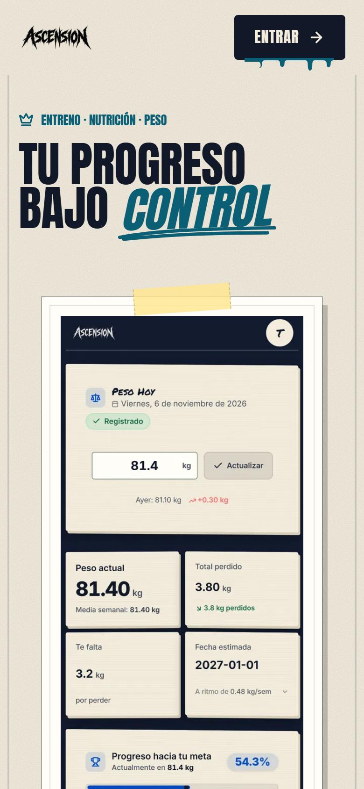
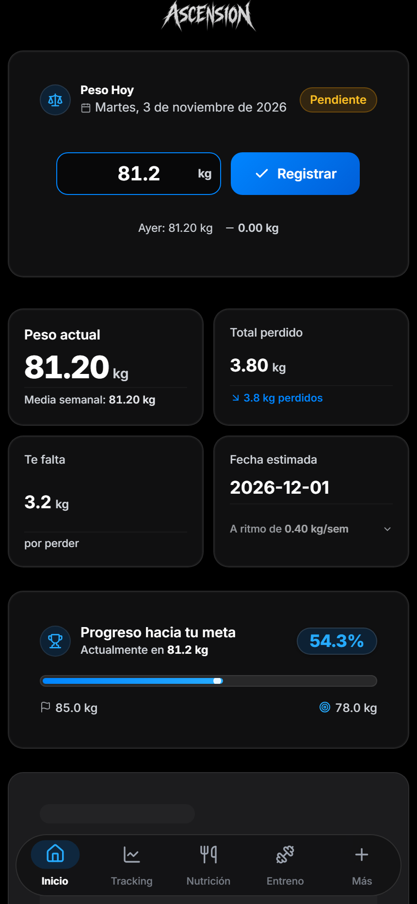
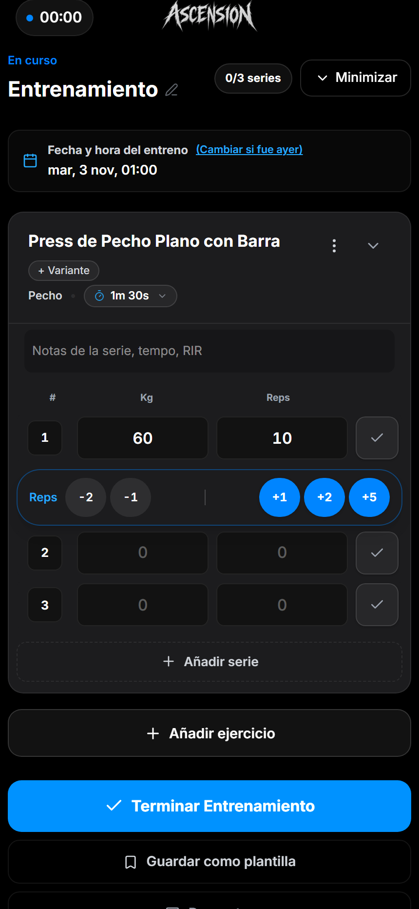
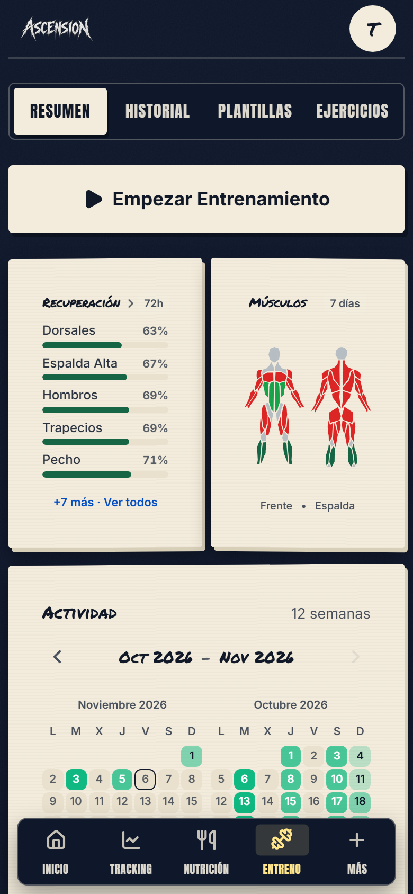
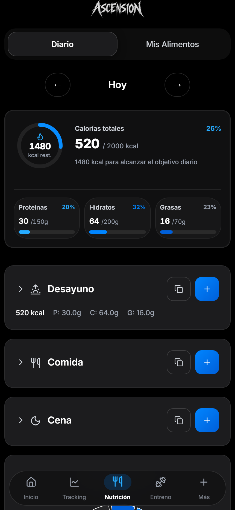
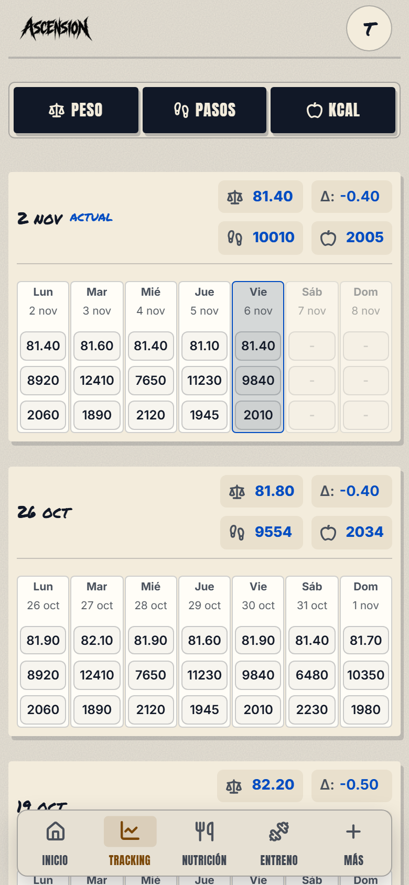
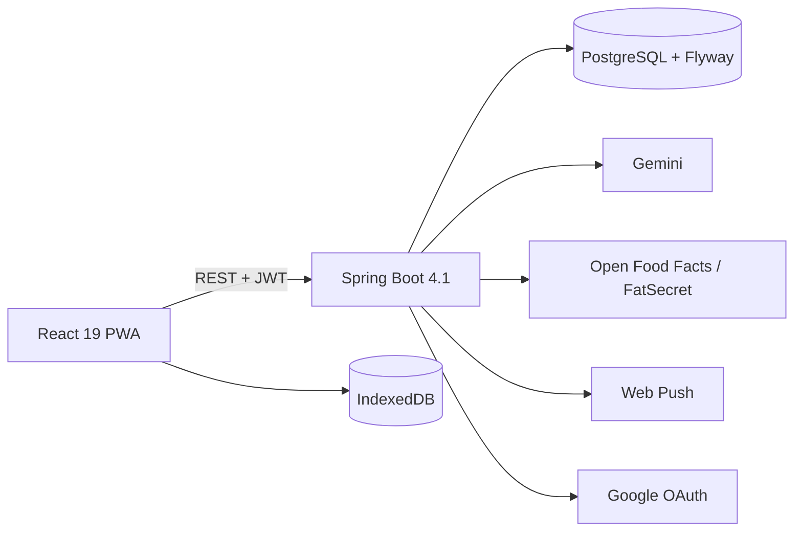

<div align="center">


# Ascension Tracker

**Entrenamiento, nutrición y progreso en una sola PWA, con modo entrenador para pautar y seguir a alumnos.**

[](https://ascension.raclos.es)
[](https://github.com/RaclosDev/ascension-tracker/actions/workflows/ci.yml)


[Arquitectura](docs/architecture.md) · [Desarrollo y pruebas](docs/development.md) · [Seguridad](SECURITY.md) · [Modo entrenador](docs/version-coach.md)

</div>

## 📱 La app

<table>
  <tr>
    <td align="center" width="33%"><br><sub><b>Portada</b> · para deportistas y entrenadores</sub></td>
    <td align="center" width="33%"><br><sub><b>Inicio</b> · peso del día y meta</sub></td>
    <td align="center" width="33%"><br><sub><b>Entreno en curso</b> · series, descansos y cronómetro</sub></td>
  </tr>
  <tr>
    <td align="center"><br><sub><b>Entreno</b> · recuperación muscular y actividad</sub></td>
    <td align="center"><br><sub><b>Nutrición</b> · calorías y macros del día</sub></td>
    <td align="center"><br><sub><b>Tracking</b> · peso, pasos y kcal por semana</sub></td>
  </tr>
</table>

<sub>Capturas de la interfaz real con datos ficticios. [Cómo se generan](docs/screenshots/README.md).</sub>

## ✨ Qué hace

- **Entrenamiento:** series, variantes, temporizador de descanso con avisos push, plantillas, historial, récords y mapa de recuperación muscular. Importa sesiones desde Hevy (CSV).
- **Nutrición:** diario por comidas, búsqueda de alimentos (Open Food Facts y FatSecret), escáner de códigos de barras, recetas y alimentos guardados.
- **Asistente con IA:** sugerencias nutricionales y recetas según los macros que te quedan, con Gemini.
- **Progreso:** peso, pasos, calorías y resúmenes semanales, fotos de progreso privadas y calculadoras de gasto energético.
- **Modo entrenador:** invitaciones a alumnos con permisos que decide el alumno, programas de entreno por semanas, pautas de nutrición, check-ins semanales y semáforo de seguimiento.
- **Tus datos son tuyos:** exportación completa y restauración de copias, con fusión o sustitución.

## 🧠 Lo interesante por dentro

| | |
| --- | --- |
| **Escrituras idempotentes** | `IdempotencyFilter` guarda la clave, la firma de la petición y la respuesta en la misma transacción. Si la conexión falla, el reintento no duplica entrenos ni comidas. |
| **Concurrencia en PostgreSQL** | Límites de uso con *token bucket* atómico compartido entre instancias, y temporizadores push reclamados con `FOR UPDATE SKIP LOCKED`. |
| **Sesión segura** | Acceso con Google, email y contraseña o llave de acceso. La API emite un JWT de acceso que vive en memoria y un refresh token rotatorio en cookie `HttpOnly`. CSP generada y verificada en CI. |
| **Local-first en el gimnasio** | El entreno en curso se guarda en IndexedDB, aislado por cuenta, y sobrevive a recargas y a una mala cobertura. |
| **Privacidad por diseño** | El alumno elige qué comparte con su entrenador, cada consulta del entrenador queda registrada y el borrado de cuenta no deja datos huérfanos. |
| **Rendimiento medido** | Tests que cuentan las consultas SQL para detectar N+1, y presupuestos de tamaño de JS, CSS y precache comprobados en CI. |



## ✅ Calidad

- **Más de 850 tests automatizados:** unos 380 de frontend (Vitest y Testing Library) y unos 475 de backend (JUnit y **Testcontainers** con PostgreSQL real).
- **E2E con Playwright** con la API simulada, incluido el aislamiento entre cuentas y el cierre de sesión entre pestañas.
- **Seguridad automatizada:** CodeQL, análisis de imágenes con Trivy y Dependabot.
- **CI en GitHub Actions** con tipos, cobertura, formato, tests y build de cada parte afectada.

## 🛠️ Stack

| Área | Tecnología |
| --- | --- |
| Interfaz | React 19, TypeScript, Vite, Tailwind CSS, PWA (Workbox) |
| Estado | TanStack Query, Zustand, IndexedDB |
| API | Java 21, Spring Boot 4.1, Spring Security (OAuth2 Resource Server), MapStruct |
| Persistencia | PostgreSQL 16, Spring Data JPA, Flyway |
| Integraciones | Gemini, Open Food Facts, FatSecret, Web Push, almacenamiento S3 |
| Pruebas | JUnit, Testcontainers, Vitest, Testing Library, Playwright |
| Automatización | GitHub Actions, CodeQL, Trivy, Docker Compose |

## 🚀 Ejecutarla en local

```bash
cp .env.example .env    # completa las claves y el cliente OAuth de Google
docker compose up --build
```

Abre [localhost:3000](http://localhost:3000). La [guía de desarrollo](docs/development.md) explica la configuración, la recarga en caliente y las verificaciones.

## 👤 Autor

**Carlos Sanz Tomero**: desarrollador full-stack Java y React.

[](https://www.linkedin.com/in/carlos-sanz-tomero/)
[](https://raclosdev.github.io)

Código publicado bajo [licencia MIT](LICENSE).
