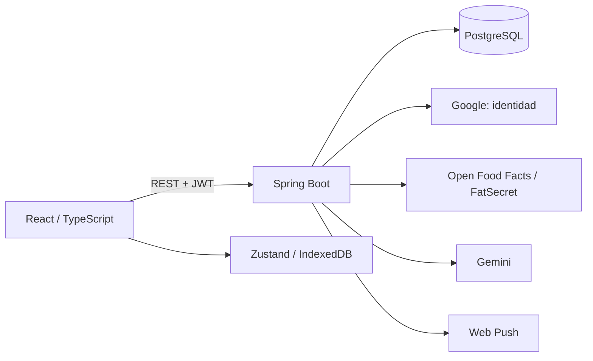

# Arquitectura

Ascension Tracker separa una SPA React de una API REST Spring Boot. PostgreSQL almacena los datos de usuario y también la coordinación que debe sobrevivir a un reinicio o compartirse entre instancias.

## Límites de responsabilidad

| Capa | Responsabilidad | Dónde empezar |
| --- | --- | --- |
| Páginas y componentes | Interacción, formularios, estados de carga y error | [frontend/src/pages](../frontend/src/pages) |
| Consultas y estado | Caché remota, mutaciones y entrenamiento activo | [hooks](../frontend/src/hooks), [workout](../frontend/src/lib/workout) |
| Cliente HTTP | Autenticación en memoria, refresh compartido e idempotencia | [api](../frontend/src/api) |
| Controladores y DTOs | Contratos HTTP, validación y usuario autenticado | [controller](../backend/src/main/java/com/ascension/controller), [dto](../backend/src/main/java/com/ascension/dto) |
| Servicios y repositorios | Reglas de negocio, transacciones y consultas | [service](../backend/src/main/java/com/ascension/service), [repository](../backend/src/main/java/com/ascension/repository) |
| Migraciones | Evolución versionada del esquema | [Flyway](../backend/src/main/resources/db/migration) |

## Integridad de las escrituras

`IdempotencyFilter` admite claves en las rutas de creación/restauración compatibles y en la fusión de ejercicios. `IdempotencyService` registra la clave, la firma de la petición y la respuesta junto con la operación de negocio. Una clave reutilizada con otro contenido devuelve 409; un error revierte la transacción. El cliente conserva las intenciones inciertas durante 24 horas y el servidor retiene los recibos durante 30 días. No se aplica indiscriminadamente a cualquier POST ni a la generación remota de IA.

Las restauraciones MERGE deduplican antes de comprobar las cuotas finales, dentro de la misma transacción. La fusión de ejercicios actualiza el historial completo y las plantillas antes de eliminar un ejercicio personalizado. Un fallo intermedio revierte el conjunto.

Las comidas tienen una identidad estable (`mealKey`). Cada registro conserva además nombre e icono históricos. La migración protege los cambios posteriores, pero no puede reconstruir información que se perdió antes de introducir esa identidad.

## Sesión y datos locales

Google acredita la identidad; el backend emite JWT de acceso y refresh tokens rotatorios. El token de acceso vive en memoria, y el refresh viaja en una cookie HttpOnly. Consulta [SECURITY.md](../SECURITY.md) para las garantías y límites exactos.

El entrenamiento activo usa claves IndexedDB por cuenta. Al cambiar de usuario se reinicia el estado visible antes de hidratar la cuenta de destino. Las respuestas tardías y los reintentos HTTP comprueban la identidad vigente. Si un entrenamiento legacy no tiene propietario identificable, se ofrece como copia recuperable en vez de asignarlo automáticamente.

El service worker permite instalar la aplicación y conservar recursos locales. La persistencia tolera errores y avisa cuando no puede guardar. No hay sincronización general de conflictos entre ediciones offline de varios dispositivos.

## Concurrencia y servicios externos

- **Cuotas HTTP:** token bucket atómico en PostgreSQL por defecto. El almacenamiento en memoria es una opción explícita; una configuración desconocida impide arrancar.
- **IA:** reservas y límites compartidos; un reembolso corresponde al día original y solo se aplica una vez. El circuito de fallos también se persiste.
- **Push:** el scheduler reclama temporizadores con `FOR UPDATE SKIP LOCKED`; un pool acotado entrega las notificaciones. La reclamación caduca, el resultado se confirma después del envío y los fallos transitorios se reintentan dentro de una ventana limitada. El tag estable permite reemplazar duplicados; no existe garantía de entrega exactamente una vez ni de visualización en el dispositivo.
- **HTTP externo:** timeouts y reintentos configurables. La descarga de certificados de Google tiene una prueba contra un servidor lento para comprobar el timeout efectivo.

No se introduce trabajo JPA en paralelo dentro de una transacción. La concurrencia se concentra en llamadas externas y en los puntos donde las pruebas demuestran que es segura.

## Rendimiento y pruebas

Las consultas paginadas se comprueban contando SQL para detectar N+1. Los resúmenes semanales materializan como máximo 520 semanas, conservando el historial exportable. El índice de récords evita recorrer todo el historial por cada ejercicio, y el reloj del entrenamiento no fuerza renderizados del layout completo.

[CONSTRAINTS.md](../CONSTRAINTS.md) fija los presupuestos de JS, CSS y precache, además de límites de tamaño de componentes y cobertura. Las mediciones locales de operaciones, consultas o renders no se presentan como Core Web Vitals de producción.

Pruebas representativas: [idempotencia](../backend/src/test/java/com/ascension/service/IdempotencyIntegrationTest.java), [fusión transaccional](../backend/src/test/java/com/ascension/service/ExerciseMergeIntegrationTest.java), [aislamiento de cuentas](../frontend/src/test/workoutAccountIsolation.test.ts) y [logout entre pestañas](../frontend/tests/durable-logout.spec.ts).
